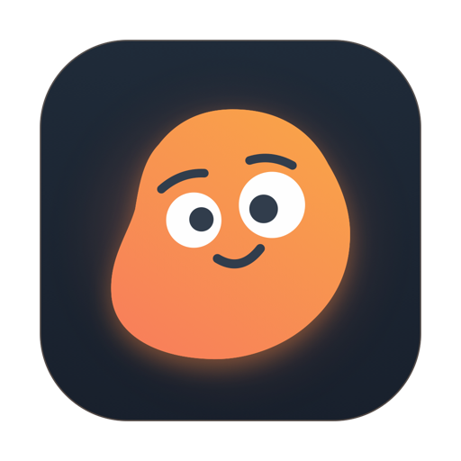
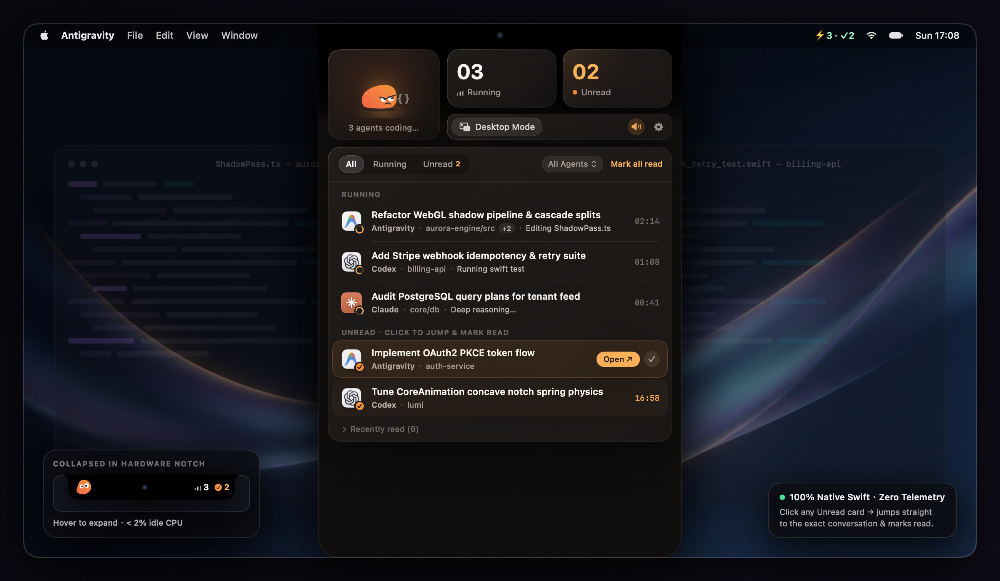
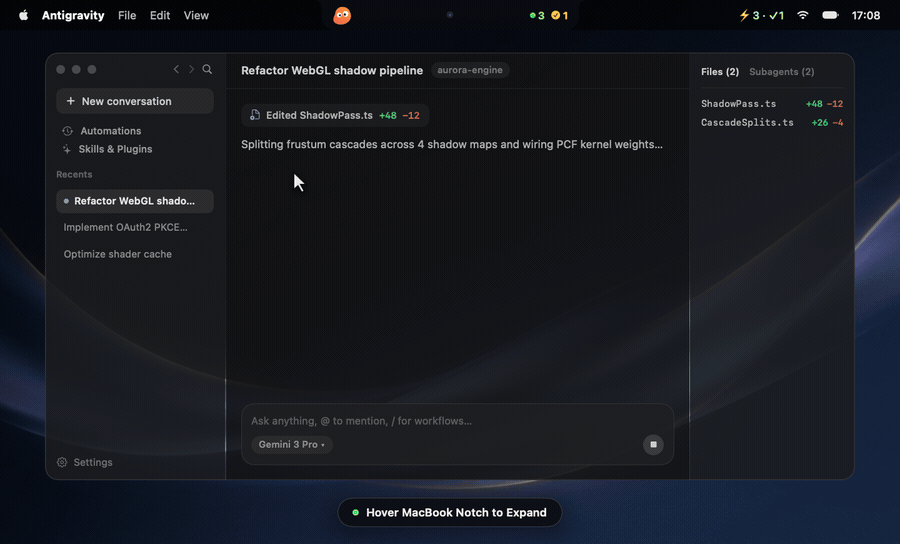
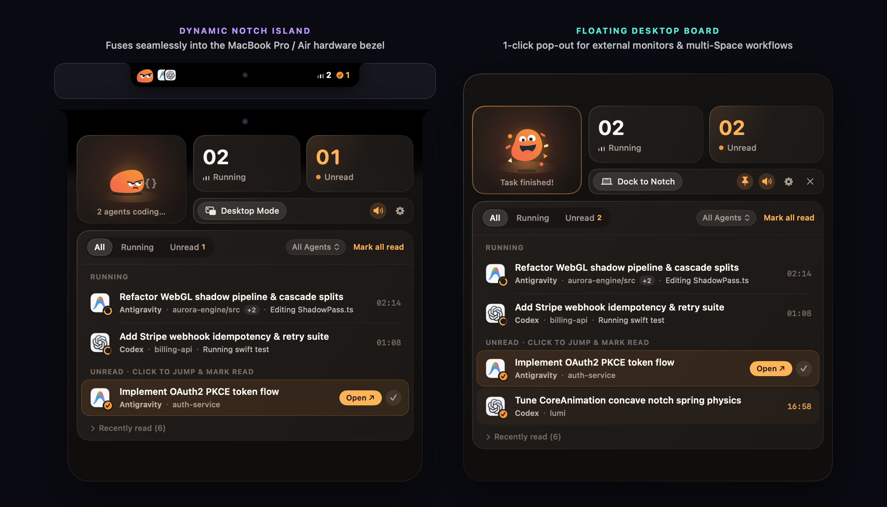
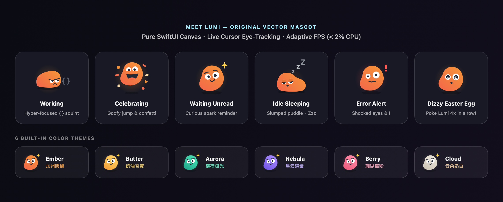
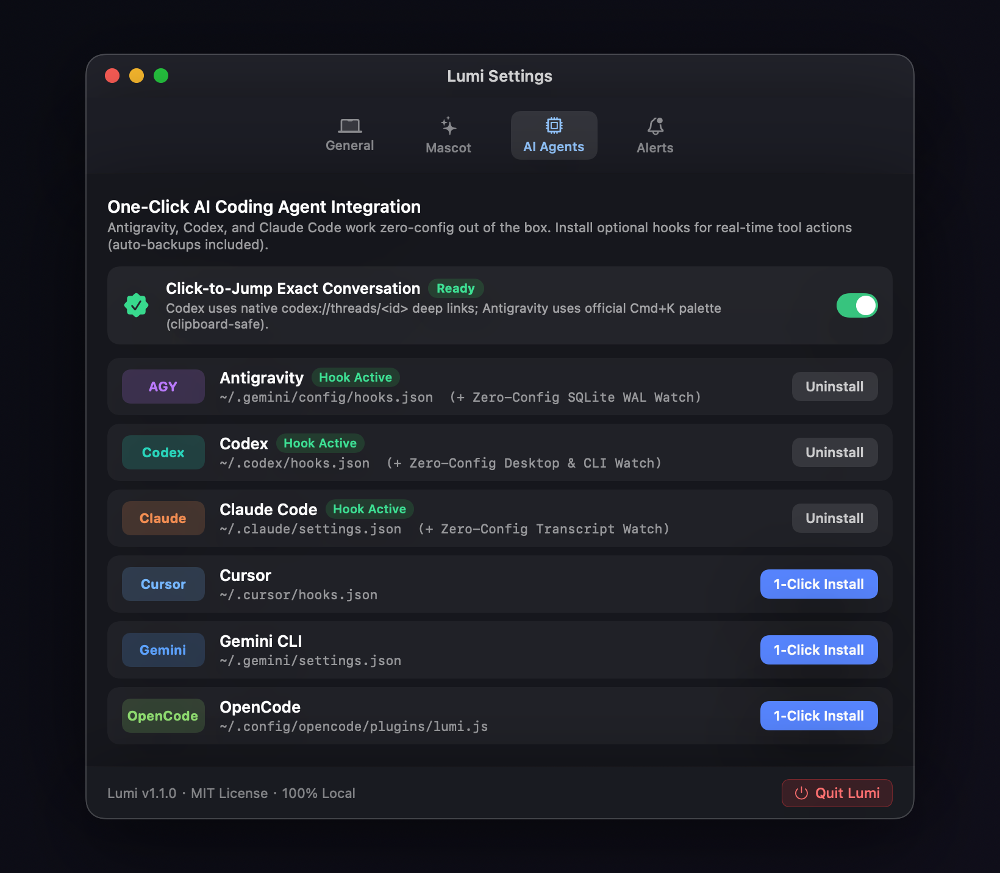
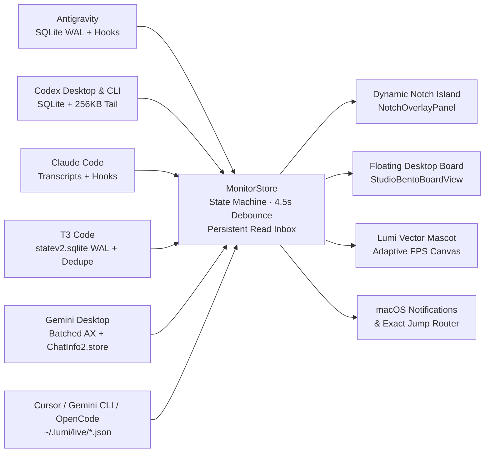

<div align="center">



# Lumi

**A glowing Dynamic Notch & Desktop Mission Control for your AI coding agents on macOS.**

*Antigravity · Codex (Desktop & CLI) · Claude Code · T3 Code · Gemini (Desktop & CLI) · Cursor · OpenCode*

**English** · [简体中文](README.zh-CN.md)

[](https://github.com/kf953741/lumi)
[](https://swift.org)
[](https://github.com/kf953741/lumi/actions/workflows/ci.yml)
[](#-privacy--architecture)
[](LICENSE)

<br />



</div>

---

## Why Lumi?

When you run 5–10 AI coding conversations in parallel across **Antigravity**, **Codex**, **Claude Code**, and **T3 Code**, existing notch widgets fall short in three frustrating ways:

1. **Every dialog gets squashed into one generic pill** — multiple sessions in the same repo collide under `lib` or `src`, so you never know *which* conversation is working.
2. **Completion banners vanish in 5 seconds** — glance away or switch Spaces, and you lose track of which window just finished.
3. **High idle CPU & flaky hooks** — constant 60 fps idle animations burn battery, CLI-only hooks miss Codex Desktop long turns, and subagents spam fake completion alerts.

**Lumi solves all three natively in pure Swift:**

| Feature | Typical Notch Trackers | **Lumi** |
| :--- | :--- | :--- |
| **Per-Dialog Visibility** | One shared pill per client | **Every standalone dialog gets its own hairline row** — real sidebar title, smart project name (`aurora-engine/src`), live tool action, and elapsed timer |
| **Completed Unread Inbox** | Fades away after ~5 seconds | **Persistent Unread Inbox (`Unread`)** — stays until you click to jump straight back to the conversation (auto-marks read!) or dismiss |
| **Exact Conversation Jump** | Only brings the app to front | **Direct thread navigation** — native `codex://threads/<id>` & `t3code://threads/<env>/<id>` deep links + official `Cmd+K` search palette jump for Antigravity (clipboard-safe) |
| **Dual Form Factor** | Notch-only or window-only | **Dynamic Notch Island ↔ 1-Click Floating Desktop Board** — collapsed notch ears show 6 expressive Lumi Ember micro-states, stacked native app icons, live solo `MM:SS` timer / `? Reply` badge, and auto-narrow when idle; auto-adapts to non-notch displays |
| **Subagent & Noise Hygiene** | Subagents & CLI jobs flood the list | Rolls active subagents into **`+N` badges** on the parent dialog; separates standalone chats from headless CLI runs; deduplicates underlying Codex/Claude/Antigravity runs launched inside T3 Code; 4.5s settle debounce prevents premature finish popups |
| **Zero-Config + Hooks** | Manual JSON editing required | **Out-of-the-box local watch** for Antigravity, Codex (Desktop & CLI), Claude Code, **T3 Code**, and **Gemini Desktop (`Gemini.app`)** + **1-click Hook Installer** (with automatic backup) across 7 AI tools |
| **Approval / Needs-Input Alerts** | Silent when agent blocks on a prompt | **Instant `Needs Input` priority section + `?` mascot alert** when Claude, Codex, Antigravity, T3 Code, or Gemini Desktop pauses for approval or a question |
| **Bilingual & Controls** | Single-language, mouse-only | **Live English / 中文 hot-switch**, global toggle hotkey (`⌥L` + `Esc`), fullscreen auto-peek guard, **Morning Oat Light** floating theme, 1-click DND mute, and manual update check |
| **Original Vector Mascot** | Static icon or 60 fps CPU burn | **Lumi Ember** — warm Californian editorial luminous bean drawn in pure SwiftUI `Canvas` with goofy asymmetric eyes, `{ }` coding squint, `?` approval cue, joyful confetti jumps, slumped `Zzz` sleep & dizzy easter egg — **adaptive FPS (< 2% idle CPU)** |

---

## Visual Tour

### Live Interactive Preview

Hover the MacBook notch to expand, watch Lumi Ember squint intensely at `{ }`, leap with goofy joy & confetti when a task completes, and single-click any Unread card to jump straight back to the conversation and auto-mark it read.

<div align="center">
  
</div>

### 1. Dynamic Notch Island ↔ Floating Desktop Board

Hover over your MacBook's hardware notch to unfold a high-contrast **Warm Charcoal Hearth** Studio Bento control center with native macOS app icons and clean Apple knockout corner status badges. Working on an external display or want a persistent side monitor? Click **Desktop Mode** to detach into a translucent always-on-top floating board that follows you across macOS Spaces.

<div align="center">
  
</div>

### 2. Meet Lumi Ember — Original Goofy-Cute Vector Mascot

Lumi Ember is drawn entirely with lineless vector SwiftUI `Canvas` (zero GIF bloat, zero third-party libraries) and reacts live to your agents and cursor with warm, goofy-cute personality:
- **Working**: Squashes forward with furrowed brows squinting intently at `{ }` code braces.
- **Celebrating**: Leaps airborne with a huge goofy open grin and flat geometric confetti the moment a conversation completes.
- **Waiting Unread**: Keeps a curious asymmetric gaze with a floating golden spark so finished work never gets missed.
- **Idle Sleeping**: Melts sideways into a cozy slumped puddle with heavy droopy eyelids and `Zzz` at **1 fps** to save battery.
- **Easter Egg**: Poke Lumi **4 times in a row** to trigger spinning `@ @` dizzy eyes!

<div align="center">
  
</div>

### 3. Zero-Config Local Watch + 1-Click Hook Installer

**Antigravity**, **Codex (Desktop & CLI)**, **Claude Code**, **T3 Code**, and **Gemini Desktop (`Gemini.app`)** work immediately with zero configuration. Want real-time per-tool actions (`Editing ShadowPass.ts`, `Running swift test`) or want to add **Cursor**, **Gemini CLI**, and **OpenCode**? Open **Settings → AI Agents** and click **Install** — Lumi always creates a timestamped backup before touching any config file.

<div align="center">
  
</div>

| Agent | Zero-Config Watch | 1-Click Hook in Settings | Real Sidebar Titles | Subagent Roll-Up | Exact Jump |
| :--- | :---: | :---: | :---: | :---: | :---: |
| **Google Antigravity** | Yes | Yes (`~/.gemini/config/hooks.json`) | Yes | Yes | `Cmd+K` Auto-Locate |
| **OpenAI Codex** (Desktop & CLI) | Yes | Yes (`~/.codex/hooks.json`) | Yes | Yes | Native `codex://` |
| **Claude Code** | Yes | Yes (`~/.claude/settings.json`) | Yes | Yes | App Focus |
| **T3 Code** | Yes (`~/.t3/userdata/statev2.sqlite`) | Not needed (auto DB watch & dedupe) | Yes | Yes | Native `t3code://` |
| **Google Gemini** (Desktop & CLI) | Yes (`Gemini.app` AX + `ChatInfo2.store`) | Yes (`~/.gemini/settings.json` for CLI) | Yes | Sidebar tasks | Window / Sidebar / `googlegemini://` |
| **Cursor** | — | Yes (`~/.cursor/hooks.json`) | Hook prompt | — | App Focus |
| **OpenCode** | — | Yes (`~/.config/opencode/plugins/lumi.js`) | Hook prompt | — | Terminal Focus |

---

## Installation

### Requirements
- **macOS 14.0+ (Sonoma or newer)** on **Apple Silicon (M1 / M2 / M3 / M4)**
- For building from source: Xcode Command Line Tools (`xcode-select --install`)

### Option 1: Install via Homebrew Cask (Fastest)

```bash
brew tap kf953741/lumi https://github.com/kf953741/lumi
brew install --cask kf953741/lumi/lumi
```

### Option 2: Download Prebuilt `.dmg`

Download the latest `Lumi-vX.Y.Z-arm64.dmg` from [GitHub Releases](https://github.com/kf953741/lumi/releases), drag **Lumi.app** into **Applications**, and launch.

### Option 3: Build & Install from Source (30 Seconds)

```bash
git clone https://github.com/kf953741/lumi.git
cd lumi

# Run unit tests
swift test

# Compile Release binary, generate 1024x1024 vector AppIcon.icns,
# sign (auto-detects Developer ID or falls back to ad-hoc), and install to /Applications/Lumi.app
./scripts/build_app.sh

# Launch Lumi
open -a /Applications/Lumi.app
```

> **Note:** To package your own distributable `.dmg` with SHA-256 checksum (optionally notarized via `LUMI_NOTARY_PROFILE`):
> ```bash
> ./scripts/package_dmg.sh 1.4.0
> ```

---

## Usage Guide

### 1. Everyday Controls & Gestures
- **Expand / Collapse Notch**: Gently move your cursor over the MacBook notch, press **`⌥L`** from anywhere (configurable in Settings; press **`Esc`** to dismiss), or click the menu bar Lumi Ember icon.
- **Jump, Duration & Auto-Read**: **Single-click** any completed row in **Unread** (displaying finish clock + total run duration) to switch directly to that conversation — Lumi automatically marks it read and moves it into **Recently Read**. Hovering also reveals a quick `✓` button to mark read without switching windows.
- **Switch Form Factor & Theme**: Click **Desktop** in the control strip to pop out into a draggable floating board (toggle between **Warm Charcoal** and **Morning Oat Light** with the `☀ / ☾` icon); click **Notch** anytime to dock back.
- **Quick Menu, DND & Language**: Right-click the warm-orange menu bar Lumi Ember icon to switch modes, enable **Do Not Disturb (30 min / 1 hr)**, hot-switch **English / 简体中文** without restarting, mark all read, open Settings, or **Quit Lumi** (`⌘Q`).

### 2. Connecting AI Coding Agents
1. Launch **Lumi** — **Antigravity**, **Codex (Desktop & CLI)**, **Claude Code**, **T3 Code**, and **Gemini Desktop (`Gemini.app`)** are tracked automatically with zero setup (including smart deduplication when T3 Code runs Codex, Claude, or Antigravity underneath).
2. Open **Settings (⚙️) → AI Agents** to enable 1-click Hooks:
   - Uses Lumi's built-in native `Lumi --hook` relay (< 5 ms, zero Python / Xcode Command Line Tools dependency, never blocks your agent).
   - Automatically verifies existing JSON and creates a timestamped backup (`*.bak-<timestamp>`) before writing; refuses to overwrite malformed/JSONC files and removes only Lumi's entry on uninstall.

### 3. Enabling Click-to-Jump
- **Codex** (`codex://threads/<id>`) and **T3 Code** (`t3code://threads/<environmentId>/<threadId>`) support native deep links out of the box — clicking any card or macOS notification jumps straight to the exact thread with zero permissions needed.
- **Gemini Desktop (`Gemini.app`)** raises the matching chat window, selects the sidebar thread, or opens `googlegemini://conversation/<id>`.
- **Antigravity** does not yet expose a conversation-ID URL scheme, so Lumi navigates cleanly via Antigravity's official **`⌘K` Search Conversations** palette (preserving & restoring your clipboard automatically).
- To enable this: open **Settings → AI Agents → Grant Permission**, and allow **Lumi** in **System Settings → Privacy & Security → Accessibility**.
- *Tip:* If you rebuild Lumi locally with an ad-hoc signature, remove the old Lumi entry (`-`) and re-add `/Applications/Lumi.app` (`+`) once. Building with a Developer ID certificate keeps Accessibility authorization intact across rebuilds automatically.

### 4. Recommended macOS Notification Style
For persistent completion banners that stay visible until you act on them:
1. Open **System Settings → Notifications → Lumi**.
2. Set alert style to **Alerts** (instead of Banners).
3. Clicking any macOS notification jumps straight back to that conversation and marks it read.

---

## Privacy & Architecture

- **100% Native Swift / SwiftUI / AppKit / SQLite3** — zero Electron, zero Node.js runtime, zero cloud calls, zero telemetry.
- **WAL-Safe Read-Only DB Access** — opens Antigravity (`conversation_summaries.db`), Codex (`state_5.sqlite`), and T3 Code (`statev2.sqlite`) with `PRAGMA query_only = ON` so Lumi **never writes or blocks checkpoints**, even when `-wal` / `-shm` sidecar files are absent between writes.
- **Long-Turn Safe Rollout Parser** — reads bounded 256 KB tail slices with `(fileSize, mtime)` caching, safely tracking 700 MB+ multi-hour Codex sessions with near-zero I/O.
- **Transient-Error Resilience & Settle Debounce** — preserves last known state across transient DB locks and applies a 4.5-second completion settle window so multi-step subagent handoffs never trigger false completion alerts.



```text
Sources/Lumi/
├── App/         # AppDelegate, Menu Bar status item, NotchWindowController (hardware notch geometry)
├── Core/        # Antigravity, Codex, Claude, T3Code, GeminiDesktop, Extra scanners, SQLiteReader, HookInstaller, MonitorStore
├── Mascot/      # LumiMascotView (Lumi Ember SwiftUI Canvas mascot with adaptive FPS & cursor gaze)
├── Models/      # AgentModels, smart ProjectNameHelper, ToolActionFormatter
└── UI/          # NotchIslandView, FloatingBoardView, StudioBentoBoardView, SessionCardView, SettingsView
```

---

## FAQ & Troubleshooting

<details>
<summary><strong>Does Lumi modify my Antigravity, Codex, or T3 Code databases?</strong></summary>

Never. `SQLiteReader` immediately sets `PRAGMA query_only = ON;` on every connection (verified by unit tests in `Tests/LumiTests/LumiCoreTests.swift`), ensuring zero writes and zero WAL checkpoint contention while remaining compatible with WAL databases even when `-wal` / `-shm` files are not currently on disk.
</details>

<details>
<summary><strong>How much CPU and memory does Lumi use?</strong></summary>

Lumi is a pure Swift/AppKit app (~2 MB binary) using adaptive animation intervals (`1 fps` idle sleeping, `5 fps` collapsed working, `24–30 fps` only when actively expanded or celebrating) and `(size, mtime)` cached tail parsing.
</details>

<details>
<summary><strong>Does it work on external monitors or Macs without a hardware notch?</strong></summary>

Yes! On non-notch displays, Lumi automatically renders a sleek floating top pill instead of hardware notch ears — or you can switch to **Desktop Mode** with one click and drag the board anywhere across all Spaces.
</details>

<details>
<summary><strong>Accessibility toggle is ON, why does Settings still show "Needs Permission"?</strong></summary>

macOS ties Accessibility TCC grants to the app's code signature. If you previously installed an ad-hoc signed build and rebuilt Lumi, open **System Settings → Privacy & Security → Accessibility**, select **Lumi**, click **`-`** to remove the stale entry, then click **`+`** to re-add `/Applications/Lumi.app`. If you have a Developer ID certificate installed, `./scripts/build_app.sh` automatically signs with it so permissions survive future rebuilds.
</details>

---

## Roadmap & Contributing

- [x] MacBook hardware notch fusion + detachable Floating Board
- [x] Zero-config local scanners for Antigravity, Codex (Desktop & CLI), Claude Code, and T3 Code (with underlying session dedupe)
- [x] 1-click Hook installer & 7-agent support
- [x] Exact conversation jump (`codex://` + `t3code://` deep links + Antigravity `⌘K`)
- [x] Homebrew Cask formula (`brew tap kf953741/lumi https://github.com/kf953741/lumi && brew install --cask kf953741/lumi/lumi`)
- [x] Live English / Chinese UI localization toggle & global board hotkey (`⌥L` / `Esc`)
- [ ] Optional per-agent notification sound customization

Contributions, bug reports, and feature ideas are warmly welcome! See [CONTRIBUTING.md](CONTRIBUTING.md) to get started.

---

## License

MIT © [Lumi Contributors](LICENSE)

<div align="center">
  <br />
  <sub>If Lumi keeps your parallel AI agents organized and saves you tab-switching every day, consider giving it a ⭐!</sub>
</div>
