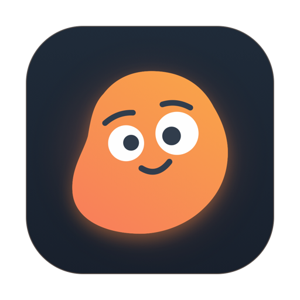
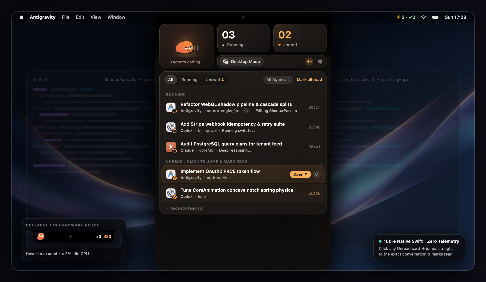
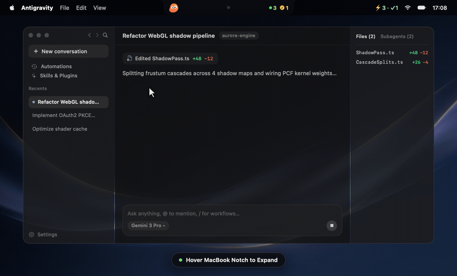
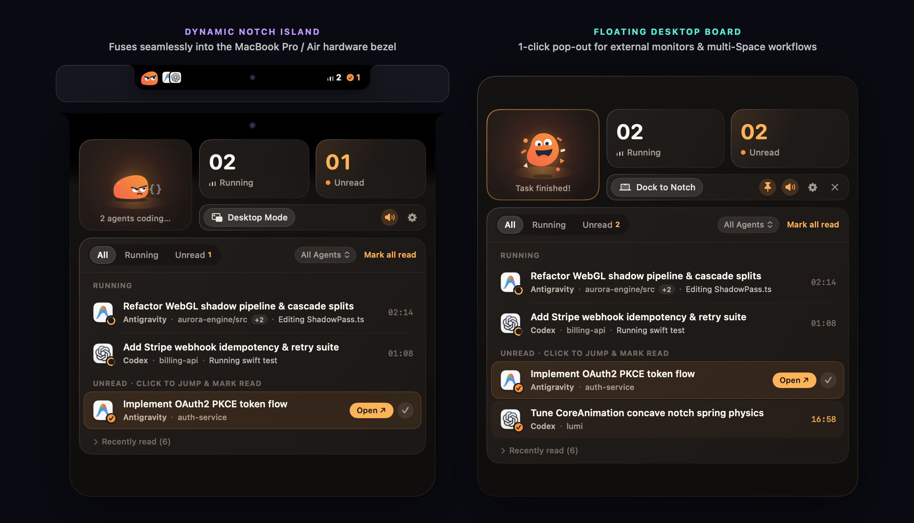
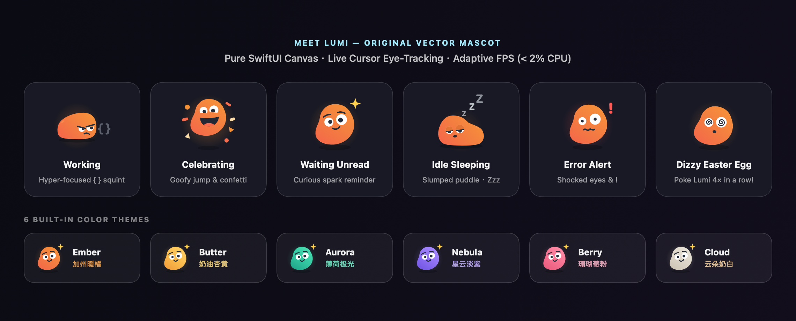
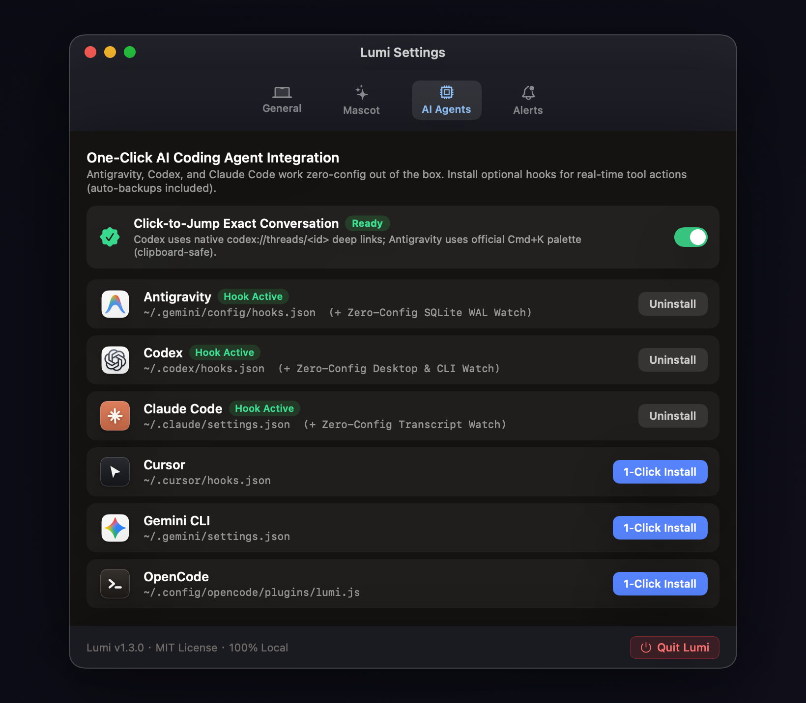
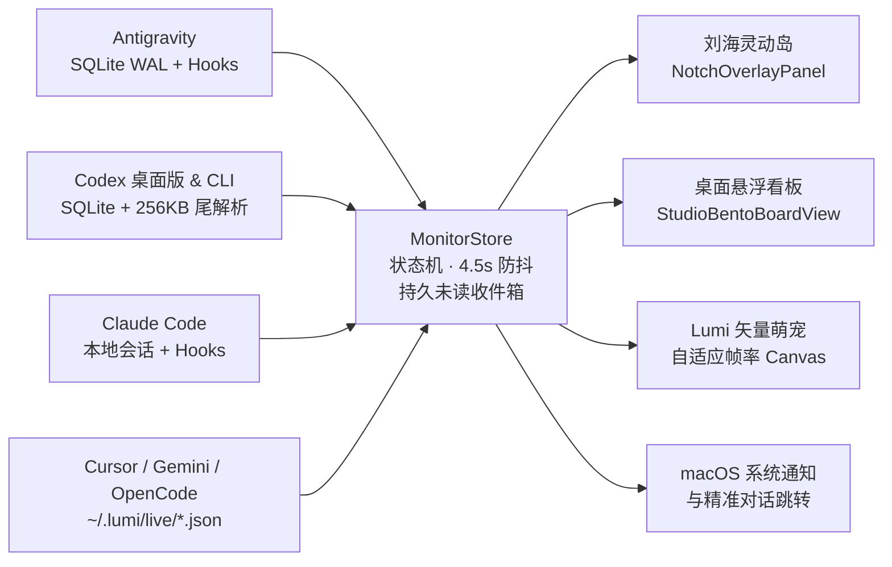

<div align="center">



# Lumi

**驻留在 MacBook 刘海灵动岛与桌面的 AI 编程 Agent 可视化盯盘中心。**

*支持 Antigravity · Codex（桌面版与 CLI）· Claude Code · Cursor · Gemini CLI · OpenCode*

[English](README.md) · **简体中文**

[](https://github.com/kf953741/lumi)
[](https://swift.org)
[](https://github.com/kf953741/lumi/actions/workflows/ci.yml)
[](#-隐私安全与架构设计)
[](LICENSE)

<br />



</div>

---

## 为什么做 Lumi？

同时开着 5～10 个 **Antigravity**、**Codex**、**Claude Code** 对话窗口并行写代码时，市面上常见的刘海/监控工具往往有三个让人抓狂的痛点：

1. **所有对话挤成一个模糊胶囊**——同一个仓库开多个窗口全都叫 `lib` 或 `src`，根本分不清到底哪个对话在干活；
2. **完成提醒 5 秒就没了**——切换一下桌面或倒杯水回来，完全不知道哪个窗口刚跑完；
3. **长任务漏报、子 Agent 刷屏、高 CPU 耗电**——常驻 60fps 动画耗电严重，Codex 桌面版超长任务容易漏抓，子 Agent 结束时还会误弹「已完成」。

**Lumi 用 100% 原生 Swift 彻底解决这些问题：**

| 对比维度 | 常见刘海监控工具 | **Lumi** |
| :--- | :--- | :--- |
| **多对话清晰度** | 一个客户端共用一个胶囊，看不到对话标题 | **每个独立对话一行清晰卡片**：显示侧边栏真实标题、智能项目名（`上级目录/src`）、实时工具动作与已用时长 |
| **已完成待查看箱** | 闪烁约 5 秒后自动清空 | **持久「待查看」收件箱**：只保留独立桌面对话，**单击卡片直接跳回对话并自动已读移出**，错过也不丢 |
| **精准直达对话** | 只切回 App 主窗口 | **直达具体会话**：Codex 使用原生 `codex://threads/<id>` 深链，Antigravity 通过官方 `⌘K` 对话搜索精准切入（不破坏剪贴板） |
| **双形态无缝切换** | 仅刘海或仅小窗 | **刘海灵动岛 ↔ 一键桌面悬浮看板**：内凹曲面无缝融进 MacBook 物理刘海，外接非刘海屏自动切换悬浮胶囊 |
| **子 Agent 折叠与防误报** | 子 Agent、CLI 批处理疯狂刷屏 | 自动把活跃子 Agent 折叠成父对话上的 **`+N` 徽标**，默认隐藏后台 CLI 批处理任务，内置 4.5 秒收尾防抖杜绝中途误报 |
| **开箱即用 + 一键 Hook** | 必须手改多份配置文件 | **Antigravity / Codex（桌面版与 CLI）/ Claude Code 零配置自动发现** + 设置页一键接入/卸载 6 家 Hook（自动备份原配置） |
| **等待审批 / 卡住强提醒** | 后台弹出权限确认完全无感知 | **即时捕捉 `等待审批或回复` 状态**：置顶亮标 + Lumi Ember 焦急 `?` 提示，绝不让你在后台白等 20 分钟 |
| **中英双语与极客交互** | 单语硬编码、纯鼠标操作 | **简体中文 / English 实时热切换**（跟随系统默认）、全局快捷键 **`⌥L` + `Esc`**、全屏防打扰、悬浮窗**晨光燕麦浅色**、一键勿扰静音与手动检查更新 |
| **原创动态矢量萌宠** | 静态图标或 60fps 常驻费电 | **原创暖橘萌宠 Lumi Ember**：不对称戏精大眼、干活死死眯眼盯 `{ }`、等审批冒 `?` 招手、完工咧嘴憨笑弹起抛几何彩纸、空闲歪倒摊平半闭眼冒 `Zzz`、连戳 4 下转晕，**自适应帧率（空闲 CPU < 2%）** |

---

## 核心界面一览

### 实时交互动效预览

悬停 MacBook 刘海丝滑展开 → Lumi Ember 眯眼盯 `{ }` 实时计时 → 任务完工憨笑跳起抛彩纸进入「待查看」→ 单击直接切到原对话窗口并自动已读。

<div align="center">
  
</div>

### 1. 刘海灵动岛 ↔ 桌面悬浮看板，双形态一键切换

平时安静贴合在 MacBook 摄像头刘海两侧，鼠标轻悬即可丝滑展开高对比度**暖炭壁炉（Warm Charcoal Hearth）** Studio Bento 面板——左侧自动呈现本机原生 macOS 应用图标与经典右下角缺口状态徽章，零彩色标签噪点；接了外接显示器或想把看板常驻在屏幕一角时，点一下 **「桌面模式」** 就能弹出跨桌面 Space 跟随的半透明悬浮窗。

<div align="center">
  
</div>

### 2. 原创暖橘萌宠 Lumi Ember（6 种情绪 × 6 套配色）

完全使用纯原生无描边 SwiftUI `Canvas` 矢量绘制，融合加州暖橘治愈美学与戏精蠢萌表情，零 GIF/Lottie 负担：
- **干活中**：歪身前倾、紧皱眉头死死眯眼盯着代码括号 `{ }`；
- **完工庆祝**：腾空跃起咧嘴憨笑，炸出简约暖色几何彩纸；
- **待查看提醒**：大小眼好奇张望，头顶飘起暖金星标；
- **空闲打盹**：直接歪倒摊成一团软糯暖橘，拉下沉重半闭眼皮、以 **1 fps** 飘出 `Zzz`；
- **彩蛋互动**：连续戳 Lumi **4 下** 会转晕冒 `@ @` 蚊香眼！

<div align="center">
  
</div>

### 3. 开箱即用 + 6 大 AI 工具一键接入

**Antigravity**、**Codex（桌面版 & CLI）**、**Claude Code** 无需任何配置打开即追踪。在 **设置 → AI 工具接入** 中点一下按钮即可挂载 Hook，获取实时工具动作并支持 **Cursor**、**Gemini CLI**、**OpenCode**（写入前自动创建带时间戳的原配置备份）。

<div align="center">
  
</div>

| AI 编程工具 | 零配置自动追踪 | 设置页一键 Hook | 真实侧边栏标题 | 子 Agent 折叠 | 点击跳转方式 |
| :--- | :---: | :---: | :---: | :---: | :---: |
| **Google Antigravity** | 支持 | 支持（`~/.gemini/config/hooks.json`） | 支持 | 支持 | `⌘K` 精准切入对话 |
| **OpenAI Codex**（桌面版 & CLI） | 支持 | 支持（`~/.codex/hooks.json`） | 支持 | 支持 | 原生 `codex://` 深链 |
| **Claude Code** | 支持 | 支持（`~/.claude/settings.json`） | 支持 | 支持 | 切回应用窗口 |
| **Cursor** | — | 支持（`~/.cursor/hooks.json`） | Hook 提示词 | — | 切回应用窗口 |
| **Gemini CLI** | — | 支持（`~/.gemini/settings.json`） | Hook 提示词 | — | 切回终端 |
| **OpenCode** | — | 支持（`~/.config/opencode/plugins/lumi.js`） | Hook 提示词 | — | 切回终端 |

---

## 安装与快速上手

### 环境要求
- **macOS 14.0（Sonoma）或更新版本**（Apple Silicon / Intel 均可）
- 源码构建需要 Xcode 命令行工具（`xcode-select --install`）

### 方式一：Homebrew 一键安装（最快）

```bash
brew tap kf953741/lumi https://github.com/kf953741/lumi
brew install --cask kf953741/lumi/lumi
```

### 方式二：下载预编译 `.dmg` 安装包

前往 [GitHub Releases](https://github.com/kf953741/lumi/releases) 下载最新版 `Lumi-vX.Y.Z-arm64.dmg`，将 **Lumi.app** 拖入「应用程序」文件夹即可运行。

### 方式三：源码一键构建安装（约 30 秒）

```bash
git clone https://github.com/kf953741/lumi.git
cd lumi

# 运行单元测试
swift test

# 编译 Release 版本、自动生成 1024×1024 矢量 AppIcon.icns、
# 自动检测本机 Developer ID 签名（或回退 ad-hoc 签名），并安装到 /Applications/Lumi.app
./scripts/build_app.sh

# 启动 Lumi
open -a /Applications/Lumi.app
```

> **自行打包发布 `.dmg`（含 SHA-256 校验值）：**
> ```bash
> ./scripts/package_dmg.sh 1.3.0
> ```

---

## 详细使用说明

### 1. 日常交互与手势
- **展开 / 收起刘海**：将鼠标轻移到 MacBook 刘海区域、随时按全局快捷键 **`⌥L`**（设置页可改 `⌃⌥L` / `⌘⇧L` / 关闭，按 **`Esc`** 立刻收起），或单击顶部菜单栏的 Lumi Ember 小豆子图标。
- **单击直达、看耗时并自动已读**：在「待查看」列表（显示完成时间 + 本次运行总耗时）**单击**任意项，Lumi 直接切到对应对话并移入「最近已读」；悬停点击小 `✓` 可仅标为已读。
- **切换刘海 / 桌面模式 & 晨光浅色**：点 **「桌面模式」** 弹出置顶悬浮窗（支持点击 `☀ / ☾` 在**暖炭深色**与**晨光燕麦浅色**之间一键切换）；点 **「回到刘海」** 随时吸回顶部，全屏看视频/演示时自动静默不乱弹。
- **右键菜单、勿扰与双语切换**：右键点击顶部菜单栏 Lumi 图标可快速切换形态、开启**勿扰静音（30 分钟 / 1 小时）**、**热切换简体中文 / English**、全部已读、打开设置或退出（`⌘Q`）。

### 2. 接入你的 AI 编程工具
1. 启动 Lumi 后，**Antigravity**、**Codex（含桌面版）**、**Claude Code** 会自动开始追踪，无需手动配置。
2. 点击齿轮打开 **设置 → AI 工具接入**，可按需一键安装各工具的 Hook：
   - 会在 `~/.lumi/lumi-hook.py` 部署极轻量的原子写入中继脚本（耗时 < 10ms，绝不阻塞宿主 Agent）。
   - 修改任意配置文件前都会自动生成 `*.bak-<时间戳>` 备份；卸载时仅精准移除 Lumi 条目，完全保留你原有的其他 Hook。

### 3. 开启 Antigravity 点击精准跳对话
- **Codex** 原生支持 `codex://threads/<id>` 深链，点击卡片即可秒切具体对话，无需任何系统权限。
- **Antigravity** 暂未开放按对话 ID 跳转的 URL Scheme，因此 Lumi 通过其官方 **`⌘K` 对话搜索面板** 自动定位目标对话（并自动保存和还原你的原剪贴板内容）。
- 开启步骤：在 **设置 → AI 工具接入** 点击 **「前往授权」**，在 **系统设置 → 隐私与安全性 → 辅助功能** 中开启 **Lumi**。
- *小贴士*：若你之前用临时 ad-hoc 签名编译过、后来重新编译导致开关开着却提示未就绪，只需在辅助功能列表中选中旧的 `Lumi` 点左下角 **`-`** 删除，再点 **`+`** 重新添加 `/Applications/Lumi.app` 即可。本机装有 Developer ID 证书时，`./scripts/build_app.sh` 会自动签名，后续更新永久不掉权限。

### 4. 推荐系统通知设置
想让任务完成通知常驻右上角直到你处理完：
1. 打开 **系统设置 → 通知 → Lumi**；
2. 将提醒样式改为 **「提醒」**（而非会自动消失的「横幅」）；
3. 直接点击右上角通知卡片即可切回目标对话并自动标为已读。

---

## 隐私安全与架构设计

- **100% 纯原生 Swift / SwiftUI / AppKit / SQLite3**——无 Electron、无 Node 运行时、零网络请求、零云端上传。
- **WAL 安全只读查询**——读取 Antigravity（`conversation_summaries.db`）和 Codex（`state_5.sqlite`）时强制开启 `PRAGMA query_only = ON`，**绝不写入数据、不争抢写锁**，且彻底兼容 WAL 模式下 `-wal` / `-shm` 文件被清理后仍稳定读取。
- **超长会话尾部解析**——对 700MB+ 的 Codex 超长运行日志仅做 256KB 尾部解析与 `(fileSize, mtime)` 增量缓存，I/O 极低且不会因日志滚动误判为已完成。
- **瞬时容错与 4.5 秒收尾防抖**——遇到瞬时数据库锁自动保留上次有效会话不闪烁；任务从运行转为空闲需稳定持续 4.5 秒才触发完工提醒，避免多步交接与子 Agent 唤醒误弹窗。



```text
Sources/Lumi/
├── App/         # AppDelegate、菜单栏状态项、NotchWindowController（物理刘海几何贴合）
├── Core/        # Antigravity / Codex / Claude / 扩展扫描器、WAL 安全 SQLiteReader、HookInstaller、MonitorStore
├── Mascot/      # LumiMascotView（Lumi Ember 原创自适应帧率 SwiftUI Canvas 暖橘萌宠）
├── Models/      # AgentModels、智能项目名消歧 ProjectNameHelper、工具动作格式化
└── UI/          # NotchIslandView、FloatingBoardView、StudioBentoBoardView、SessionCardView、SettingsView
```

---

## 常见问题（FAQ）

<details>
<summary><strong>Lumi 会修改或锁定我的 Antigravity / Codex 数据库吗？</strong></summary>

不会。`SQLiteReader` 建立连接后立即执行 `PRAGMA query_only = ON;`（已在 `Tests/LumiTests/LumiCoreTests.swift` 中通过单元测试验证写操作被严格拒绝），既保证了零写入、不阻塞宿主 checkpoint，又解决了 WAL 数据库在 `-wal`/`-shm` 缺失时普通只读模式报错的问题。
</details>

<details>
<summary><strong>Lumi 后台挂着费电吗？</strong></summary>

非常轻量。纯原生 Swift 编译产物仅约 2MB，萌宠采用按场景动态降频（空闲打盹 1fps、折叠干活 5fps、仅展开查看或庆祝瞬间升至 24–30fps），搭配文件增量缓存，日常挂后台几乎不占资源。
</details>

<details>
<summary><strong>没有刘海的老款 Mac 或外接显示器能用吗？</strong></summary>

完全支持！在无物理刘海的屏幕上，Lumi 会自动切换为顶部半透明悬浮胶囊；你也可以随时一键切到 **桌面模式**，把看板拖放到任意屏幕角落并跨桌面 Space 跟随。
</details>

<details>
<summary><strong>系统设置里辅助功能开关已经开了，为什么还提示未授权？</strong></summary>

macOS 会将辅助功能权限绑定到应用的签名标识。如果之前运行过临时 ad-hoc 签名版、重新编译后覆盖了 App，只需在 **系统设置 → 隐私与安全性 → 辅助功能** 中选中 `Lumi` 点左下角 **`-`** 删掉旧项，再点 **`+`** 重新添加 `/Applications/Lumi.app` 即可。
</details>

---

## 路线图与参与贡献

- [x] MacBook 物理刘海无缝贴合 + 一键弹出桌面悬浮看板
- [x] Antigravity、Codex（桌面版 & CLI）、Claude Code 零配置自动监测
- [x] 6 大 AI 编程工具一键 Hook 安装与安全备份
- [x] 精准对话跳转（Codex 原生深链 + Antigravity 官方 `⌘K`）
- [x] Homebrew Cask 一键安装（`brew tap kf953741/lumi https://github.com/kf953741/lumi && brew install --cask kf953741/lumi/lumi`）
- [ ] 界面中/英文语言一键切换
- [ ] 分平台自定义提示音 & 全局快捷键呼出面板

欢迎任何形式的 Issue、PR 与建议！详情请参考 [CONTRIBUTING.md](CONTRIBUTING.md)。

---

## 开源协议

基于 [MIT License](LICENSE) 开源。

<div align="center">
  <br />
  <sub>如果 Lumi 帮你把多窗口并行写代码的体验拉满，别忘了点一颗 ⭐ Star 支持一下！</sub>
</div>
